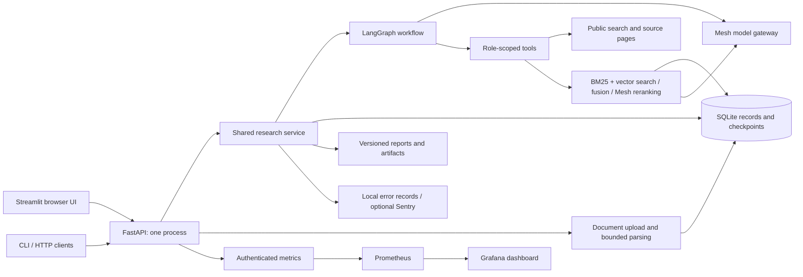
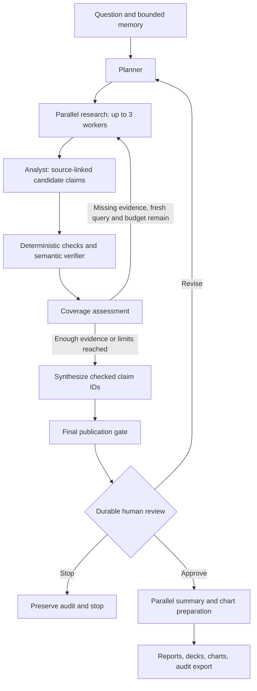
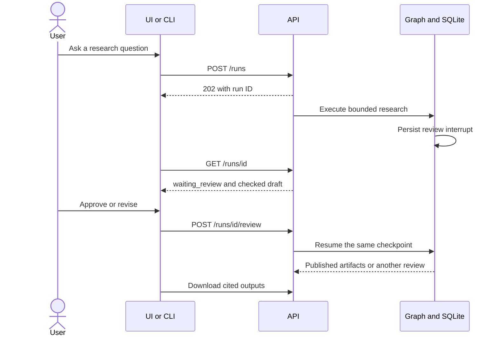

# DeepDive

[Live demo](https://deepdive-web-production.up.railway.app) · [Repository](https://github.com/Ben-cod1ng/DeepDive) · [Quality CI](https://github.com/Ben-cod1ng/DeepDive/actions/workflows/quality.yml)

**Follow the evidence.** DeepDive researches a question, saves the passages behind its claims, checks those claims, and pauses for your review before producing reports and presentations.

Built for Agent Arena 2026 with Python, LangGraph, FastAPI, and Streamlit. Every model request goes through **Mesh**. Public web discovery and direct page retrieval need no additional paid API key.

**Deployment note (October 21):** the competition improvements are merged and pass
[main-branch CI](https://github.com/Ben-cod1ng/DeepDive/actions/runs/39570547946).
Railway temporarily paused new builds, so the live demo still runs the earlier
application. The recorded gallery and new citation panels can be tried locally
with the setup below. [Deployment evidence and remaining checks](evaluation/results/competition-validation.json).

## What you can do

- Investigate a question with parallel primary-source, reporting, and community researchers.
- Upload PDF, DOCX, TXT, or Markdown documents and research them using BM25 + vector search, rank fusion, and Mesh reranking. Choose documents only or combine them with public web sources.
- Inspect exact source passages, accepted and rejected claims, missing evidence, and the research timeline.
- Open a finding's **Inspect evidence** panel for its full passage, exact quotation, source date, and verification reason. Follow repair decisions by round and compare revised drafts.
- Approve, revise, or stop a saved review; resume interrupted work after a restart.
- Keep isolated sessions or share verified research within an explicit project. Inspect, edit, and forget saved memory.
- Export cited Markdown/HTML reports, HTML/PowerPoint presentations, source-backed PNG charts, and JSON audit records.
- Run the same service from the browser, API, or CLI. Operate it with Docker, health checks, structured logs, error tracking, Prometheus, and Grafana.

**Validation status:** [Competition Quality CI](https://github.com/Ben-cod1ng/DeepDive/actions/runs/39498872999) passed **78 tests**, dependency audit, Docker ingestion/removal, Railway storage/private-network checks, and monitoring checks. Regression tests use explicitly synthetic model responses and vectors; live measurements are recorded separately below.

The [October 20 passage-level comparison](evaluation/results/competition-rag.json) tested 50 chunks across seven queries. Mean Recall@3 on six answerable queries was **0.8611 for hybrid fusion and 0.9444 after reranking**. The answer-absent query is excluded from that mean. All seven reranking calls completed; these small, authored relevance labels await independent review. [Methods, all ranking stages, and limitations](docs/rag.md#measured-passage-level-results).

A [real web retest](evaluation/results/competition-benchmark-v2.json) retained seven of eight candidate claims after a quotation-formatting fix; the [initial unsuccessful pilot](evaluation/results/competition-benchmark.json) remains available. This is verifier acceptance, not independently measured answer accuracy. The earlier [32-case live verifier result](evaluation/results/live-verifier.json) has its own code manifest and unreviewed labels. Independent label/final-report review, the complete ten-scenario benchmark, release-image promotion, and organizer submission acceptance remain pending. See [the checklist](tasks/todo.md) and [evaluation guide](docs/evaluation.md).

A [scripted live document acceptance run](evaluation/results/live-document-acceptance.json) also passed upload, research, revision, backend restart at review, approval, and eight artifact downloads through the deployed API. Three retrievals used the documented hybrid-order fallback after invalid reranker output; the report also repeated one finding. These limitations are retained in the validation record.

## Architecture





## Judge walkthrough and evidence

Start with [the judge walkthrough](docs/judge-walkthrough.md). Recorded examples
can be opened without new model calls; live investigations still use the normal
review and spending limits. [The evidence index](evaluation/results/README.md)
distinguishes current experiments from older measurements.

| Judging area | Implementation | Inspect |
|---|---|---|
| Agent orchestration | LangGraph fan-out, sequential verification, bounded repair | [workflow](deepdive/workflow.py), Timeline |
| Verification and self-evaluation | Exact-quote/number gates, semantic verification, coverage, durable review | [verification](deepdive/verification.py), finding evidence panels |
| Ingestion and domain research | Public pages, PDF/DOCX/text, BM25/vectors/fusion/reranking | [RAG design and measurements](docs/rag.md) |
| Auditability | Immutable passages, claim-version decisions, per-round records, exports | [judge walkthrough](docs/judge-walkthrough.md) |
| Reproducibility | Frozen cases, isolated resumable benchmark, persistent spending ledger | [evaluation guide](docs/evaluation.md) |
| Deployment | Docker, private API, public frontend, persistent volume, CI/monitoring | [Railway](docs/railway.md), [operations](docs/operations.md) |



## Share a hosted demo

Open the [live demo](https://deepdive-web-production.up.railway.app) and enter the
demo code provided by the project owner with the judging materials. Visitors share
one workspace, so use public or sample documents. The API and Mesh credentials
stay private.

To try document research, expand **Documents · upload and manage**, choose a TXT,
Markdown, PDF, or DOCX file, and click **Upload to library**. Select **Documents only**
and your document in **Research settings**, ask a question, inspect the draft and evidence,
then choose **Approve and generate exports**. A saved synthetic policy example is
available in the research library.

The [Railway deployment guide](docs/railway.md) explains the two services,
persistent storage, access-code setup, and operations. The demo uses temporary
hosting credit; availability depends on Railway and Mesh balances.

[Hosted browser acceptance](evaluation/results/railway-hosted.json) passed login,
document upload, live Mesh research, review/approval, seven artifact downloads,
backend restart persistence, and logout on October 20, 2026. This is a small
synthetic workflow check, not an independent accuracy benchmark.

## Quick start: local development

Prerequisites: **Python 3.13** and **uv**. Commands below run from the `DeepDive` folder. The lockfile is shared by development, CI, and Docker.

```powershell
cd DeepDive
uv sync --frozen --extra dev
uv run python -m deepdive.ops init
```

The initializer creates `.env`, an API token, and Docker secret files without printing credentials. Open `.env` locally and set `MESH_API_KEY` when available. Keep the default `MESH_MODEL=openai/gpt-4o` unless your Mesh account requires another supported model. Never paste keys into a question or commit them.

Start the backend in terminal 1:

```powershell
uv run python -m uvicorn deepdive.api:app --host 127.0.0.1 --port 8000 --workers 1 --no-access-log
```

Start the UI in terminal 2, also from `DeepDive`:

```powershell
uv run streamlit run streamlit_app.py --server.address 127.0.0.1 --server.port 8501
```

Open **http://127.0.0.1:8501**. These commands also work in a POSIX shell. If `uv` cannot access its default cache, add `--cache-dir .uv-cache` to the `uv` command. Restart the backend after changing model credentials.

Startup, history browsing, health checks, and offline tests work without Mesh credentials. Starting real research requires a key and network access. The first local model request may download the tokenizer vocabulary; Docker downloads it during its build.

## Quick start: Docker

Install Docker with Compose, then initialize secrets using the local setup command above. From `DeepDive`:

```powershell
docker compose config --quiet
docker compose build api
docker compose up --no-build --wait --wait-timeout 180
uv run python -m deepdive.ops health
uv run python -m deepdive.smoke
```

The API and UI use one image. Research lives in the persistent `deepdive_research` volume; `.env` and `.secrets` are excluded from the image. Ports bind to localhost. Containers run as a non-root user with a read-only root filesystem. Do not run the local backend and Docker backend on the same port.

```powershell
# Optional local monitoring
docker compose --profile monitoring up -d
uv run python -m deepdive.monitoring_smoke

# Stop services while keeping research
docker compose --profile monitoring down
```

Grafana: **http://127.0.0.1:3000**, username `admin`, password in `.secrets/grafana_admin`. Prometheus: **http://127.0.0.1:9090**. Use the provisioned DeepDive dashboard. See [operations](docs/operations.md) for backup, restore, alerts, upgrades, and rollback.

## Your first investigation

1. Choose an isolated session or create a research project in the sidebar.
2. Ask a specific question. Add public source URLs in Research settings if search discovery is blocked.
3. Read the draft and inspect Evidence, Verification, and Timeline. Missing facets remain visible.
4. Approve to generate downloads, revise with concrete feedback, or stop. Manual review is the default.
5. Ask a follow-up in the same session. Select **Refresh sources** when freshness matters.

Example CLI flow, with the API running:

```powershell
uv run python -m deepdive.cli health
uv run python -m deepdive.cli research "How do SQLite WAL checkpoints affect readers?" --source https://www.sqlite.org/wal.html --wait
uv run python -m deepdive.cli status RUN_ID
uv run python -m deepdive.cli review RUN_ID approve
uv run python -m deepdive.cli export RUN_ID --output research-audit.json
```

Replace `RUN_ID` with the returned ID. `--auto` explicitly skips manual approval. [API reference and examples](docs/api.md) cover custom clients and all session/memory operations.

## Research your documents

Open **Documents · upload and manage** in the UI, upload a PDF, DOCX, TXT, or Markdown file, then select **Documents only** in Research settings and ask your question. Files are parsed locally; the first research run creates embeddings through Mesh. Documents only disables public web tools. **Documents and public web** allows search queries to include document-derived information.

Chunks preserve page/section locations and use bounded overlap. Retrieval combines **BM25 and dense cosine search**, applies **reciprocal rank fusion**, and reranks candidates through Mesh before the existing evidence verification and review loop. Reports retain source passages and locations.

Defaults use `MESH_EMBEDDING_MODEL=openai/text-embedding-3-small` with the existing Mesh key. Uploads are limited to 5 MB and 128 chunks per file. Scanned PDFs need OCR first. See the [document RAG guide](docs/rag.md) for CLI/API examples, limits, caching, deletion, diagrams, and retrieval evaluation.

## Quality and MLOps

```powershell
uv run ruff check deepdive tests streamlit_app.py
uv run mypy
uv run python -m compileall -q deepdive streamlit_app.py
uv run pytest -q
uv run python -m deepdive.evaluation fixtures --output evaluation/results/fixture-gates.json
uv run pip-audit
```

Type checks currently cover configuration and public Pydantic contracts; they are not a claim of strict typing across the whole application.

CI runs these gates, builds and starts Docker, checks HTTP persistence/UI health, and verifies Prometheus scraping, alert rules, and Grafana's provisioned dashboard queries. Release automation reruns quality checks and live verifier evaluation before publishing a commit-tagged GHCR image. Deployment uses the published immutable image digest. GitHub environments, credentials, independent labels, and a destination host must be configured before a remote release can succeed.

This project consumes hosted models; its MLOps work covers **versioned prompts/code, evaluation datasets, reproducible experiment manifests, quality gates, drift/calibration, runtime telemetry, and rollback**. It does not train a model. No live accuracy percentage is claimed from fixtures.

## Documentation map

| Guide | Use it for |
|---|---|
| [Architecture](docs/architecture.md) | Agent roles, evidence contracts, memory, caches, boundaries |
| [API](docs/api.md) | Endpoints, authentication, run lifecycle, client examples |
| [Document RAG](docs/rag.md) | Uploads, chunking, BM25/vector search, reranking, citations, retrieval evaluation |
| [Operations](docs/operations.md) | Docker, health, monitoring, errors, backup/restore, deployment |
| [Evaluation](docs/evaluation.md) | Labels, precision/recall, benchmarking, calibration, release gates |
| [Railway demo](docs/railway.md) | Public frontend, private API, persistent volume, and shared demo access |
| [Decisions and scope](docs/decisions.md) | Approved-plan extensions and engineering tradeoffs |
| [Contributing](CONTRIBUTING.md) | Local checks and changing the project safely |
| [Completion checklist](tasks/todo.md) | Implemented work versus pending validation |
| [Approved plan](PLAN.md) | Original approved design; later scope is recorded separately |

## Operating boundary

DeepDive uses one shared workspace. Local Docker services bind to loopback. The
[Railway demo](docs/railway.md) exposes only the HTTPS frontend and requires a
separate demo code; the API and its token stay private. Admitted visitors share
research, documents, and the Mesh budget. Separate accounts and tenant isolation
are not implemented. Keep monitoring services private.

Public pages may block automation, omit content, or change. Document extraction supports text-based PDFs and DOCX/TXT/Markdown; OCR and image interpretation are not implemented. Source snapshots and audit exports can contain private questions and retrieved text: share them deliberately, and protect backups.
