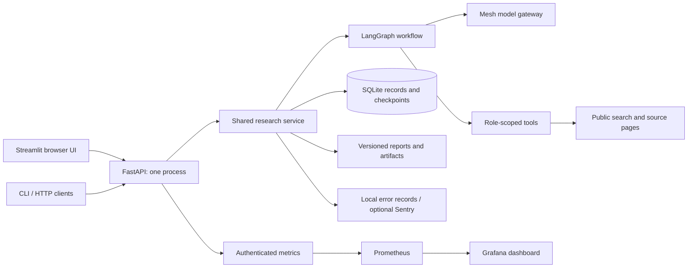
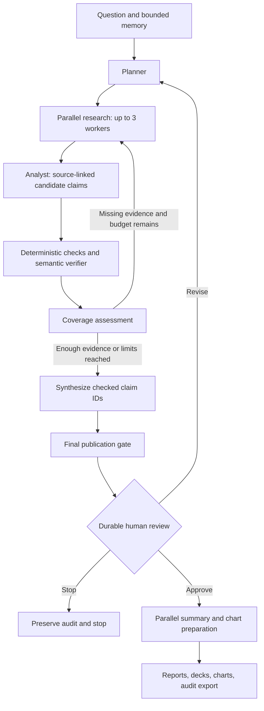
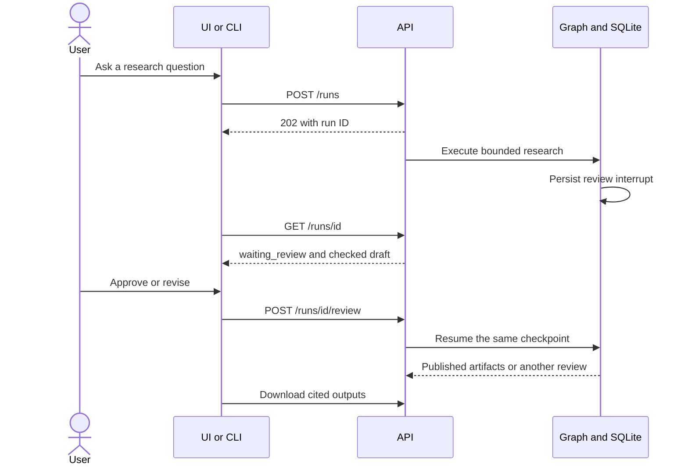

# DeepDive

[Repository](https://github.com/Ben-cod1ng/DeepDive) · [Quality CI](https://github.com/Ben-cod1ng/DeepDive/actions/workflows/quality.yml)

**Follow the evidence.** DeepDive researches a question, saves the passages behind its claims, checks those claims, and pauses for your review before producing reports and presentations.

Built for Agent Arena 2026 with Python, LangGraph, FastAPI, and Streamlit. Every model request goes through **Mesh**. Public web discovery and direct page retrieval need no additional paid API key. The earlier `Advanced-LangGraph-Implementation` project remains separate.

## What you can do

- Investigate a question with parallel primary-source, reporting, and community researchers.
- Inspect exact source passages, accepted and rejected claims, missing evidence, and the research timeline.
- Approve, revise, or stop a saved review; resume interrupted work after a restart.
- Keep isolated sessions or share verified research within an explicit project. Inspect, edit, and forget saved memory.
- Export cited Markdown/HTML reports, HTML/PowerPoint presentations, source-backed PNG charts, and JSON audit records.
- Run the same service from the browser, API, or CLI. Operate it with Docker, health checks, structured logs, error tracking, Prometheus, and Grafana.

**Validation status:** 41 local tests pass. GitHub Quality CI passed its Linux tests, dependency audit, Docker deployment, and full monitoring HTTP checks; API/UI and monitoring checks also passed on the local Docker host. Public retrieval/search worked in a recorded live check. Workflow tests use explicitly synthetic model responses. Live Mesh research, independent label review, live accuracy measurement, and release/submission acceptance remain pending. Automated source verification can be wrong; coverage and correctness are reported separately. See [the completion checklist](tasks/todo.md) and [evaluation guide](docs/evaluation.md).

## Architecture







## Quick start: local development

Prerequisites: **Python 3.13** and **uv**. Commands below run from the `DeepDive` folder. The lockfile is shared by development, CI, and Docker.

```powershell
cd DeepDive
uv sync --frozen --extra dev
uv run python -m deepdive.ops init
```

The initializer creates `.env`, an API token, and Docker secret files without printing credentials. Open `.env` locally and set `MESH_API_KEY` when available. Keep the default `MESH_MODEL=openai/gpt-4o` unless your Mesh account requires another supported model. Never paste keys into a question or commit them.

Start the backend in terminal 1:

```powershell
uv run python -m uvicorn deepdive.api:app --host 127.0.0.1 --port 8000 --workers 1 --no-access-log
```

Start the UI in terminal 2, also from `DeepDive`:

```powershell
uv run streamlit run streamlit_app.py --server.address 127.0.0.1 --server.port 8501
```

Open **http://127.0.0.1:8501**. These commands also work in a POSIX shell. If `uv` cannot access its default cache, add `--cache-dir .uv-cache` to the `uv` command. Restart the backend after changing model credentials.

Startup, history browsing, health checks, and offline tests work without Mesh credentials. Starting real research requires a key and network access. The first local model request may download the tokenizer vocabulary; Docker downloads it during its build.

## Quick start: Docker

Install Docker with Compose, then initialize secrets using the local setup command above. From `DeepDive`:

```powershell
docker compose config --quiet
docker compose build api
docker compose up --no-build --wait --wait-timeout 180
uv run python -m deepdive.ops health
uv run python -m deepdive.smoke
```

The API and UI use one image. Research lives in the persistent `deepdive_research` volume; `.env` and `.secrets` are excluded from the image. Ports bind to localhost. Containers run as a non-root user with a read-only root filesystem. Do not run the local backend and Docker backend on the same port.

```powershell
# Optional local monitoring
docker compose --profile monitoring up -d
uv run python -m deepdive.monitoring_smoke

# Stop services while keeping research
docker compose --profile monitoring down
```

Grafana: **http://127.0.0.1:3000**, username `admin`, password in `.secrets/grafana_admin`. Prometheus: **http://127.0.0.1:9090**. Use the provisioned DeepDive dashboard. See [operations](docs/operations.md) for backup, restore, alerts, upgrades, and rollback.

## Your first investigation

1. Choose an isolated session or create a research project in the sidebar.
2. Ask a specific question. Add public source URLs in Research settings if search discovery is blocked.
3. Read the draft and inspect Evidence, Verification, and Timeline. Missing facets remain visible.
4. Approve to generate downloads, revise with concrete feedback, or stop. Manual review is the default.
5. Ask a follow-up in the same session. Select **Refresh sources** when freshness matters.

Example CLI flow, with the API running:

```powershell
uv run python -m deepdive.cli health
uv run python -m deepdive.cli research "How do SQLite WAL checkpoints affect readers?" --source https://www.sqlite.org/wal.html --wait
uv run python -m deepdive.cli status RUN_ID
uv run python -m deepdive.cli review RUN_ID approve
uv run python -m deepdive.cli export RUN_ID --output research-audit.json
```

Replace `RUN_ID` with the returned ID. `--auto` explicitly skips manual approval. [API reference and examples](docs/api.md) cover custom clients and all session/memory operations.

## Quality and MLOps

```powershell
uv run ruff check deepdive tests streamlit_app.py
uv run mypy
uv run python -m compileall -q deepdive streamlit_app.py
uv run pytest -q
uv run python -m deepdive.evaluation fixtures --output evaluation/results/fixture-gates.json
uv run pip-audit
```

Type checks currently cover configuration and public Pydantic contracts; they are not a claim of strict typing across the whole application.

CI runs these gates, builds and starts Docker, checks HTTP persistence/UI health, and verifies Prometheus scraping, alert rules, and Grafana's provisioned dashboard queries. Release automation reruns quality checks and live verifier evaluation before publishing a commit-tagged GHCR image. Deployment uses the published immutable image digest. GitHub environments, credentials, independent labels, and a destination host must be configured before a remote release can succeed.

This project consumes hosted models; its MLOps work covers **versioned prompts/code, evaluation datasets, reproducible experiment manifests, quality gates, drift/calibration, runtime telemetry, and rollback**. It does not train a model. No live accuracy percentage is claimed from fixtures.

## Documentation map

| Guide | Use it for |
|---|---|
| [Architecture](docs/architecture.md) | Agent roles, evidence contracts, memory, caches, boundaries |
| [API](docs/api.md) | Endpoints, authentication, run lifecycle, client examples |
| [Operations](docs/operations.md) | Docker, health, monitoring, errors, backup/restore, deployment |
| [Evaluation](docs/evaluation.md) | Labels, precision/recall, benchmarking, calibration, release gates |
| [Decisions and scope](docs/decisions.md) | Approved-plan extensions and engineering tradeoffs |
| [Contributing](CONTRIBUTING.md) | Local checks and changing the project safely |
| [Submission](docs/submission.md) | Organizer requirements and outstanding external steps |
| [Completion checklist](tasks/todo.md) | Implemented work versus pending validation |
| [Approved plan](PLAN.md) | Original approved design; later scope is recorded separately |

## Operating boundary

DeepDive is a **single-owner local workspace**. Its API token is a service credential, not a multi-user account system. Keep the default loopback bindings. Internet hosting requires an authenticated TLS ingress and an explicit host configuration review; Streamlit, Prometheus, and Grafana should not be exposed directly.

Public pages may block automation, omit content, or change. PDF/uploaded-document research and image interpretation are outside this implementation. Source snapshots and audit exports can contain private questions and retrieved text: share them deliberately, and protect backups.
