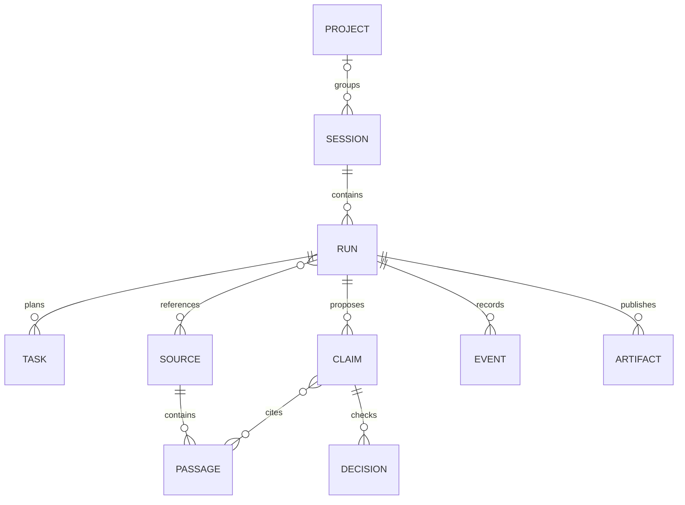

# Architecture and evidence flow

DeepDive uses a modular Python service with one API process and one active run worker. Three graph research tasks may run concurrently inside that worker. This keeps SQLite ownership, cancellation, and review transitions straightforward. The queue holds at most eight pending runs; this is not a horizontally scaled, multi-tenant service.

## Code map

| Module | Responsibility |
|---|---|
| `api.py`, `client.py`, `cli.py` | HTTP contracts and shared clients |
| `service.py` | Run lifecycle, queue, ownership lock, final gate, persistence coordination |
| `workflow.py` | LangGraph nodes, fan-out, barriers, repair, durable review |
| `gateway.py` | Mesh calls, schema validation, token allocation, retry and request budgets |
| `tools.py`, `retrieval.py` | Role-scoped tools, public-network retrieval and extraction |
| `documents.py`, `document_parser.py`, `rag.py` | Bounded uploads, immutable document passages, BM25/vector fusion and Mesh reranking |
| `guardrails.py`, `verification.py` | Input boundaries, citations, numbers, semantic support decisions |
| `storage.py`, `memory.py` | SQLite records, FTS search, scoped caches and memory |
| `artifacts.py` | Cited reports, charts, tables, slide decks, atomic output writes |
| `evaluation.py` | Datasets, metrics, manifests, quality gates, calibration and drift |
| `observability.py`, `ops.py` | Logs, metrics, errors, setup, readiness, backup and restore |

## Agents and tools

The planner turns the question into bounded tasks with explicit facets. Primary, reporting, and community researchers share retrieval tools but have different evidence priorities. The analyst proposes atomic claims. The verifier checks each claim against its complete cited passages. The coverage assessor maps supported claims to required facets and proposes targeted queries for gaps. The synthesizer and summarizer select checked claim IDs.

Tool access is explicit per role. Tools include public search, source retrieval, evidence search, passage/table reading, source-bound arithmetic, explicit-symbol market retrieval, and memory recall. Agents cannot execute arbitrary code, edit files, publish directly, or change their own tool permissions. Tool results and failures enter the audit record.

Search snippets only identify candidate pages. A usable claim needs a saved source passage or captured structured data. Retrieval prefers primary material, then secondary reporting, then attributed community material; this heuristic ranking never overrides verification.

## Evidence model

Records are JSON documents in SQLite with a kind, ID, scope, timestamp, and full-text index. This diagram describes logical relationships; it is not a claim that each entity has a separate relational table. Source and passage records are immutable. A changed page creates a new snapshot with its retrieval time and content hash. Failed retrieval attempts remain events rather than fabricated source records.

Claims retain task IDs, exact quotations, passage IDs, and a fact/opinion/derived classification. Verification decisions bind to a hash of the claim version. The final gate checks both that binding and the evidence again. Editing a claim after verification invalidates its decision.

The renderer uses the exact accepted claim text. Model-generated headings cannot introduce unsupported factual claims. Quantitative charts use literal captured table values or market-series values; images and their metadata are not interpreted as data. Calculations retain operands and formulas, and the semantic verifier also receives the original input passages.

Unresolved disagreements from the coverage assessor are labeled as unverified assessments in limitations. They must not be mistaken for verified findings. Independent human review of disagreement interpretation remains part of live acceptance testing.

## Bounded execution

| Setting | Default | Maximum |
|---|---:|---:|
| Subquestions | 4 | 6 |
| Concurrent researchers | 3 | 3 |
| Sources | 30 | 30 |
| Candidate claims | 40 | 40 |
| Additional research rounds | 2 | 2 |
| Model requests, including retries | 80 | 80 |
| Active execution seconds | 900 | 900 |

Review waiting time is excluded from active execution. Time/cancellation are checked at work boundaries; an in-flight external request can finish after a limit is reached. Mesh requests have a 45-second timeout. Request reservations are atomic across concurrent tasks. The SDK's automatic retries are disabled; the gateway permits one transient retry and one formatting repair, recording every actual attempt.

Model inputs have a 24,000-token allocation and outputs a 5,000-token ceiling. The tokenizer is an estimate, not a provider billing oracle. If its vocabulary is unavailable, a conservative UTF-8 byte count protects the allocation. Oversized verifier batches split into smaller groups without truncating cited passages. Oversized analyst context drops whole passages with omitted IDs recorded. An individually oversized claim context cannot receive a passing verifier decision.

Repair stops when limits are reached or another pass yields no new usable sources. Sparse findings still show missing facets. No supported findings yields an insufficient-evidence outcome.

## Short- and long-term memory

Short-term context includes the three recent session turns, bounded feedback, selected preferences, and relevant evidence. Older turn summaries are deterministic indexes of saved history. Long-term project memory contains source-linked findings promoted after publication; preferences are saved only through an explicit user action.

Memory retrieval uses SQLite FTS, avoiding an additional embedding provider. Scope is either the isolated session or its selected project. Recent preferences and matching memory excerpts have explicit context limits; omitted IDs are recorded. Full saved records remain inspectable. A remembered statement is context for research, not evidence that bypasses fresh verification.

Editing, forgetting, or clearing memory invalidates scoped caches. Clearing memory does not erase session history. Deleting a session removes its runs, outputs, own memory, and unreferenced evidence. A source still cited by another run in the same project remains available to that run.

## Caching

| Cache | Lifetime / invalidation |
|---|---|
| Search | Up to 1 hour |
| Ordinary page | Up to 24 hours |
| Time-sensitive page | Up to 15 minutes |
| Market response | Up to 5 minutes |
| Extraction | Content hash and extractor version, up to 1 day |
| Supported verifier decision | Claim, passage hashes, model, prompt and policy; up to 1 day, with source freshness checked again |
| Exact report | Question/context/preferences/model/code fingerprint; at most 1 hour and no longer than source freshness |
| Document retrieval | Selected corpus/query/model/profile/retrieval version; up to 1 hour |
| Query embeddings | Scoped exact query and embedding profile; up to 1 hour |
| Chunk embeddings | Persistent immutable passage/profile vectors; model/revision changes create a separate profile |

Caches are scoped; concurrent identical work is coalesced. Entries are capped and expire. Refresh bypasses reuse. Report reuse creates a new run with its own review, claim IDs, decisions, and audit trail. This is exact/context-aware caching, not an unvalidated semantic-similarity cache.

## Guardrails and trust boundaries

Inputs use Pydantic schemas, bounded questions/URLs/settings, a 200 KB HTTP body cap (5 MB only for document upload), a queue limit, and the local API token. Public retrieval rejects non-public addresses, credentials in URLs, unsafe schemes/ports, and unsafe redirects. DNS results are validated and connections pin a validated address while retaining TLS hostname verification. Responses have size/type limits and per-host pacing.

Document research adds a separate, scoped hybrid retrieval path. It preserves PDF page/Markdown or DOCX section boundaries, combines BM25 and exact dense cosine rankings using reciprocal rank fusion, and reranks candidates through Mesh. Document-only mode blocks all public retrieval tools. Uploaded text remains untrusted evidence and passes the same claim/publication gates. See [document RAG](rag.md) for the diagram, limits, and cache/deletion contract.

Retrieved text is untrusted evidence and may contain prompt injection. Prompts state this boundary; role restrictions and output gates enforce concrete consequences. These controls reduce exposure but do not prove that an LLM cannot be manipulated.

The publication boundary validates passage existence, exact quotations, numeric consistency, semantic verdicts, claim hashes, and source freshness. HTML text is escaped and downloads are constrained to the run's registered artifacts. Secrets matching supported key patterns are redacted; this is not a universal PII detector.

## Persistence and recovery

`deepdive.sqlite3` holds application records; the LangGraph checkpoint database holds durable state. Only one service may own a data directory. Restart marks unfinished active work interrupted; resume is explicit. The same checkpoint handles UI, API, and CLI review decisions. Idempotency keys protect retried creation/review requests. Artifact files are versioned and written atomically.

Back up both databases and artifacts together with the service stopped. See [operations](operations.md). Multi-instance scheduling, distributed tracing, remote vector databases, and model training are deliberately absent from this single-owner deployment.
