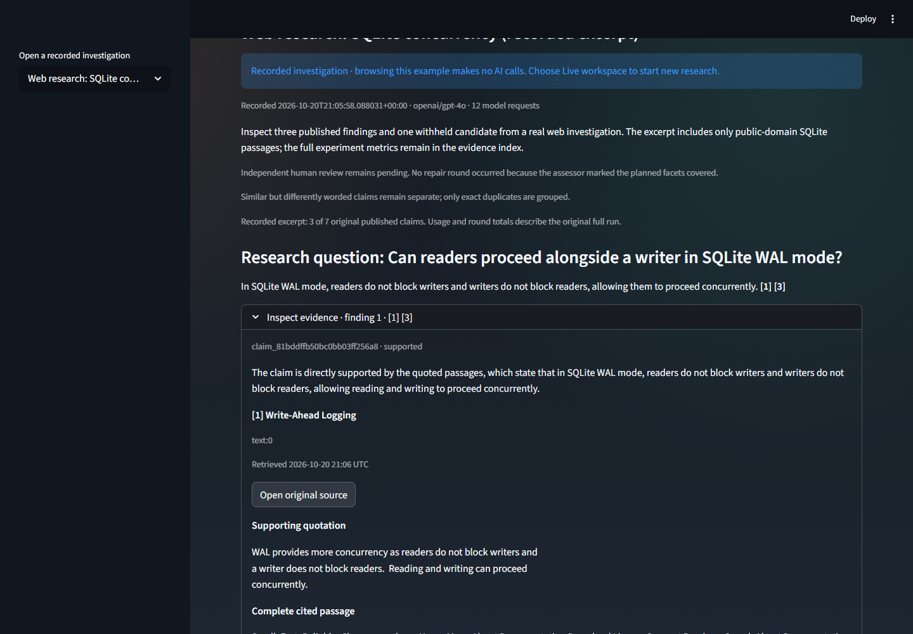

# Inspect a DeepDive investigation

Open the [demo](https://deepdive-web-production.up.railway.app) and enter the
owner-provided demo code. Use public or sample documents: this is a shared
workspace. The demo code is separate from the private API and Mesh credentials.

**October 21 deployment status:** Railway rejected the competition deployment
during its build outage. The gallery and new panels below are available in the
local application; hosted acceptance of them is pending. The existing hosted
annual-leave investigation remains accessible. Check the
[deployment record](../evaluation/results/competition-validation.json) before a demo.

1. In the sidebar, choose **Open a recorded investigation**. These are actual
   saved runs with original dates, model usage, claims, decisions, and provenance.
   Reading them does not call Mesh or the backend. Each example states its limits.
2. Open **Inspect evidence** under a finding. Compare its exact supporting quote
   with the complete cited passage, source, location, date, and verification reason.
   Numbered references map to immutable passage IDs in the evidence download.
3. Read **Research rounds**. New runs show missing facets, supported claim IDs,
   new evidence, and why another search was selected or stopped. Older examples
   may predate these snapshots; their limitations say so. A coverage assessment
   is not an independently verified claim.
4. Inspect **Verification decisions**. Unsupported or contradicted candidates
   remain in the audit but cannot enter published findings. Only demonstrate a
   rejection or successful repair when that example's records show one.
5. Download the recorded Markdown report and evidence JSON. Return to **Live
   workspace** to try a new question using the owner's remaining credit.

The screenshot below shows the local candidate's actual citation panel, with the
API deliberately unavailable. It is a recorded web excerpt, not a new live run.

For a live demonstration, select a saved session or create a new one. Upload a
small public document, select **Documents only**, and ask a specific question.
Use manual review. Inspect the evidence, select **Revise** with concrete feedback,
then inspect **Changes since the previous draft** before approving exports.
New claim IDs alone do not count as changed findings: text, claim kind, and evidence
are compared. Numeric, date, and polarity differences remain distinct.

The default workflow fans out research and runs analysis, verification, and
coverage sequentially. It can search again after an empty first round when a new
query and budget remain. Repeated ineffective queries stop with a recorded reason.
Parallel summary/chart preparation begins only after approval.

## Evidence boundaries

Application regressions, live model measurements, authored relevance labels, and
independent human review are separate evidence categories. Follow the
[current evidence index](../evaluation/results/README.md). The reviewed-label
release threshold remains precision >= 0.90 and recall >= 0.50; a passing UI test
does not satisfy it. Incomplete benchmark cases remain listed as not run.

## Submission checklist

Provide the public GitHub repository, live demo URL and separate demo code, and
the required walkthrough/media in the organizer dashboard. Configure the
dashboard's `SUBMISSION_TOKEN` and the existing `MESH_API_KEY` privately in GitHub
Actions secrets. The official workflow must run on the selected commit and its
dashboard result must be checked. Never substitute our application CI for the
organizer's eligibility check. See the [official rules](https://career.krishnaik.in/hackathons/agent-arena-2026)
for the required fields and October 30 deadline.
