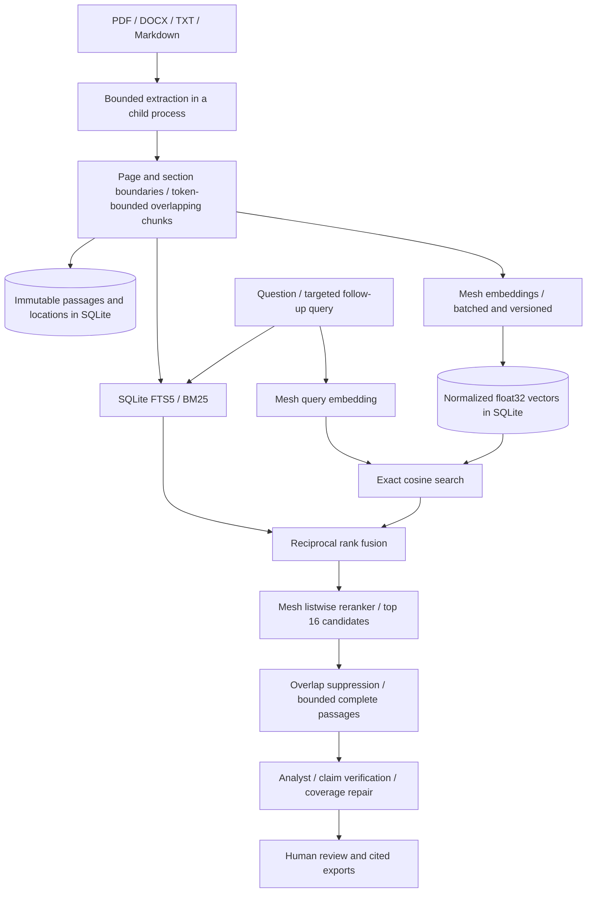

# Research with your documents

DeepDive accepts text-based PDF, DOCX, UTF-8 TXT, and Markdown files. Uploading extracts and indexes text locally. Starting research sends selected document chunks to Mesh for embeddings and sends retrieved passages to Mesh for reranking, reasoning, and verification. Original binary files are not retained; the library stores extracted text, source hashes, locations, and index data.

## Start in the browser

1. Start the API and UI using the [README](../README.md). Configure `MESH_API_KEY` for real research.
2. Select a session or project. Open **Documents · upload and manage**, choose files, and click **Upload to library**. An isolated session is created if none is selected.
3. Review extraction warnings. Scanned PDFs need OCR before upload. DOCX uses section locations because pagination is not stable outside the original renderer.
4. In **Research settings**, choose **Documents only** and select the documents for this question. This is the default when the selected library contains documents.
5. Ask a question. The first run embeds missing chunks; later runs reuse matching vectors. Inspect **Evidence** for passages and locations, **Verification** for claim decisions, and **Timeline** for retrieval and cache events.
6. Approve, revise with feedback, or stop. Reports, slides, and audit exports retain evidence references. HTML/Markdown references include page/section and character locations.

**Documents and public web** enables both sources. Public search queries can include information from uploaded documents. Choose this mode deliberately; **Documents only** disables search, page fetching, and market retrieval at the tool boundary. Both modes still send model inputs to Mesh.

## CLI and API

Use an existing session ID from the UI or `python -m deepdive.cli sessions`:

```powershell
uv run python -m deepdive.cli upload ./report.pdf --session SESSION_ID
uv run python -m deepdive.cli documents --session SESSION_ID
uv run python -m deepdive.cli research "What does this report conclude?" --session SESSION_ID --mode documents --document DOCUMENT_ID --wait
uv run python -m deepdive.cli review RUN_ID revise --feedback "Compare the evidence in the methods and conclusion."
uv run python -m deepdive.cli review RUN_ID approve
```

Replace uppercase IDs with returned values. Repeat `--document` for multiple files. Use `--project PROJECT_ID` instead of `--session` to upload to a shared project. `--mode mixed` explicitly allows public retrieval. See [API endpoints](api.md) for direct HTTP use.

Uploads use a raw `application/octet-stream` request, with `filename` and exactly one of `session_id`/`project_id` as query parameters. This avoids base64 overhead. The existing local bearer token is required when configured.

## Retrieval design



| Stage | Implemented behavior |
|---|---|
| Extraction | Preserve PDF page numbers, Markdown headings, DOCX heading sections and table-row text. Never execute macros, follow document relationships, or fetch embedded URLs. |
| Chunking | Up to 384 tokens, at most 64 tokens of word-aligned overlap. Prefer paragraph/sentence breaks; never cross a page or section. Character slicing preserves Unicode and exact quote offsets. |
| Lexical retrieval | FTS5 BM25, with title/section weights of 2 and body weight of 1. Literal token queries are escaped; selected source IDs and scope filter candidates before the top-32 cutoff. |
| Dense retrieval | Default `openai/text-embedding-3-small` through Mesh. Normalize vectors and compute exact cosine similarity over selected chunks; take top 32. Validate dimensions, finite values, nonzero norms, and batch indexes. |
| Fusion | Reciprocal rank fusion with constant 60. It combines ranks without treating BM25 and cosine scores as comparable quantities. |
| Reranking | The configured Mesh chat model orders the best 16 candidates jointly. Output must be a permutation of supplied IDs. No generated replacement passages enter the evidence store. |
| Context | Suppress substantially overlapping windows, preserve complete passages, and bound results. Mixed research interleaves document and web results. Contradictory passages remain eligible. |
| Verification | Retrieval relevance is not factual support. The existing quotation, number, claim-version, semantic-support, and publication gates still apply. Missing evidence remains a visible gap. |

The chunk sizes are explicit starting values, not a universal optimum. Use the versioned retrieval evaluation before tuning them for a new corpus. There is no evidence yet that these settings maximize live retrieval quality. No local embedding model or separate reranking provider bypasses Mesh.

Exact vector search fits the bounded local collection and avoids another service or an approximate index with separate recovery requirements. A larger corpus would require measured latency/recall targets and a deliberate migration to an indexed vector backend. This implementation does not claim an ANN index.

## Limits and failure behavior

| Boundary | Limit |
|---|---|
| File | 5,000,000 bytes; PDF/DOCX/TXT/MD only |
| Extraction | 240,000 characters; PDF up to 200 pages; no silent truncation |
| PDF content stream | 2 MB per page after decoding, with child-process containment |
| DOCX archive | Up to 1,000 entries / 20 MB expanded / 4 MB document XML; encrypted, macro, and duplicate-entry archives rejected |
| Parser | 30-second wall timeout; Linux child additionally limited to 512 MiB address space and 20 CPU seconds |
| Document | 128 chunks; split larger files before upload |
| Scope | 50 active documents / 2,048 active chunks |
| Research selection | 10 documents / 512 chunks, also within the run's source limit |
| Embeddings | Up to 32 chunks per request; attempts count against the existing 80-call run maximum |

Windows extraction uses input limits and the subprocess timeout; the Linux memory/CPU limits do not apply on Windows. The parser is process-isolated, not a complete security sandbox. Docker supplies an additional memory limit. Complex layouts, images, scanned text, headers, footnotes, and OCR are outside the extractor's guarantees. Inspect passages before trusting conclusions.

Embedding failures or inconsistent dimensions fail explicitly. Successful batches persist so a resumed indexing node can reuse them. Reranker schema/budget failures retain the fused ordering and record `document_rerank_fallback`; audit results set `reranked: false`. Provider transport failures propagate. The system never labels lexical-only results as hybrid retrieval.

## Cache, deletion, and recovery

Vectors are stored by passage ID and an embedding profile containing gateway, model, operator revision, and chunker version. Content changes create new document/source IDs. Parser/format versions also contribute to document identity. Query vectors and reranked results have a one-hour scoped cache. Retrieval keys include the selected corpus, query, embedding profile, reranking model, and retrieval version. Report keys also include document selection and research mode.

Set `MESH_EMBEDDING_MODEL` to a Mesh-supported model if needed. Increment `MESH_EMBEDDING_REVISION` when the provider changes an embedding deployment under the same model ID. Restart the backend and start a new run to build that profile. Old and new vector dimensions are never mixed. **Refresh** bypasses query/result/report reuse; unchanged immutable chunk embeddings remain reusable.

**Remove from library** disables future selection and removes its stored vectors, while preserving passages cited by existing reports. Finish or cancel unfinished runs before removal. Deleting an isolated session removes its documents, passages, indexes, vectors, and research. Shared project documents stay available when one project session is deleted. Backups can still contain removed content; manage backup retention separately.

The SQLite backup already includes the document library, FTS tables, and vectors; no remote index snapshot is needed. New tables are created additively on startup. Existing web-only runs remain usable. Back up before upgrading, and restore the matching backup when rolling back an application/data version.

## Evaluate retrieval

```powershell
uv run python -m deepdive.rag_evaluation --output evaluation/results/live-rag.json
```

This command requires Mesh access and uses a separate evaluation data directory. The authored dataset has ten small documents and seven questions covering synonyms, exact error codes, policy versions, negation, procedures, and contradictory sources. It records document-level **Recall@3, MRR@3, and nDCG@3** for BM25, dense, fused, and final rankings, plus latency, usage, model/profile, code/lock hashes, and dataset version. Results are saved after each question. A fallback is recorded rather than presented as successful reranking.

The [live Mesh run on October 19, 2026](../evaluation/results/live-rag.json) completed all seven questions with `openai/text-embedding-3-small` and `openai/gpt-4o`. All seven queries used validated reranking, with 15 model requests and 7,699 reported tokens across indexing and retrieval.

| Ranking stage | Mean Recall@3 | Mean MRR@3 | Mean nDCG@3 |
|---|---|---|---|
| BM25 | 0.8571 | 0.8571 | 0.8571 |
| Dense | 1.0000 | 1.0000 | 1.0000 |
| Hybrid fusion | 1.0000 | 0.9286 | 0.9473 |
| Final reranked | 1.0000 | 1.0000 | 1.0000 |

Labels are authored synthetic examples and await independent review. These ten small documents are useful for regression investigation, not a claim of production accuracy or a demonstrated advantage over dense retrieval on this dataset. Add independently reviewed examples from the intended corpus and a held-out set before tuning chunk sizes, candidate counts, or ranking prompts.

Design references: [Mesh embeddings](https://developers.meshapi.ai/docs/capabilities/embeddings), [SQLite FTS5/BM25](https://www.sqlite.org/fts5.html#the_bm25_function), [reciprocal rank fusion paper](https://plg.uwaterloo.ca/~gvcormac/cormacksigir09-rrf.pdf), [LLM reranking research](https://arxiv.org/abs/2304.09542), and [pypdf extraction limits](https://pypdf.readthedocs.io/en/stable/user/extract-text.html).

## Passage-level competition corpus

`evaluation/documents.v2.json` freezes 55,029 characters from two public SQLite
documentation pages plus an explicitly incorrect synthetic draft. Each public
snapshot records its URL, retrieval time, original response hash, extracted-text
hash, extraction method, and [public-domain permission](https://www.sqlite.org/copyright.html).
The snapshot builder refuses to overwrite an existing freeze. Superseded source
text remains marked as superseded. The draft includes a conflicting table.

Seven questions cover single writers, network storage, an exact checkpoint macro,
locking semantics, a dated version change, contradictory sources, and an answer
absent from the corpus. Exact reference quotations identify eligible chunks;
overlapping chunks containing the quotation count separately as relevant. Labels
remain authored and unreviewed. Two development queries and five held-out queries
are identified before inference.

```powershell
# No credentials or model calls:
uv run python -m deepdive.rag_evaluation --dataset evaluation/documents.v2.json --offline --output evaluation/results/competition-chunk-audit.json
# Paid comparison; use the SAME persistent ledger/allocation as the research benchmark:
uv run python -m deepdive.rag_evaluation --dataset evaluation/documents.v2.json --ledger .secrets/evaluation-ledger.json --max-spend-usd $evaluationAllocation --reserve-usd $demoReserve --output evaluation/results/competition-rag.json
```

The offline audit found 50 chunks, exact source offsets, and all labeled quotations
contained in complete chunks. This supports keeping the existing 384/64 defaults;
it does **not** establish that this is an optimal chunk size. The live command
records both document- and passage-level Recall@3/MRR@3/nDCG@3, actual rankings,
latency, requests/tokens, and rerank fallback categories. Answer-absent ratios are
null and excluded from means; returned passages are counted explicitly. Retrieval
alone does not decide whether an answer is supported. Formatting retries provide
sanitized schema field/type feedback; invalid permutations, schema failures,
context limits, and budget limits are recorded separately.
