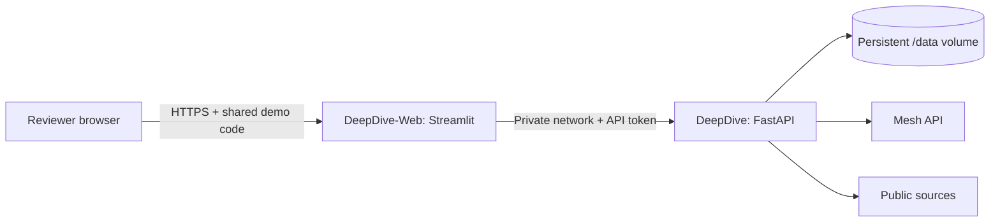

# Railway hackathon demo

This deployment gives reviewers a public browser link and a shared demo code.
Everyone admitted shares the same research, documents, and Mesh budget. Use public
or synthetic documents. It is a demonstration workspace, without separate user
accounts or tenant isolation. The independently reviewed accuracy release gate in
[evaluation.md](evaluation.md) remains separate and has not been passed.

The deployed demo is **https://deepdive-web-production.up.railway.app**. Obtain the
demo code from the project owner or the judging materials; it is not stored in
this public repository. The saved **Demo: annual leave policy (synthetic)** session
shows a completed document research example without requiring another model call.

## Services



Deploy two services from this repository in the same Railway project and
environment. Only the frontend needs a public domain. Railway builds the root
Dockerfile; it does not run Compose. Keep one replica per service and one API
worker. Extra API replicas cannot share this SQLite workspace safely.

The instructions assume the backend service is named **DeepDive**. If renamed,
update the service name in the frontend's Railway variable references below.

## 1. Backend: DeepDive

In the backend service's **Variables** tab, set:

| Name | Value |
|---|---|
| `MESH_API_KEY` | Your Mesh key; enter it privately in Railway |
| `DEEPDIVE_API_TOKEN` | A random secret of at least 32 characters; local setup generates one in `.env` |
| `DEEPDIVE_DATA_DIR` | `/data` |
| `PORT` | `8000` |
| `RAILWAY_RUN_UID` | `0` |

Keep the default Mesh chat and embedding models unless the account requires a
change. Do not copy local `DEEPDIVE_API_TOKEN_FILE` paths into Railway.

Close the service panel. Right-click empty project canvas and choose **Create
Volume**, select **DeepDive**, and use **`/data`** as its mount path. Railway adds
`RAILWAY_VOLUME_MOUNT_PATH` automatically. A new volume begins empty; it does not
import local research or files written before the volume was attached.

Railway mounts volumes as root. `RAILWAY_RUN_UID=0` permits our startup code to
assign the mount directory to UID/GID 10001. The code then clears supplementary
groups and permanently drops to that user before starting the API. It does not
recursively alter existing files. Keep the default Docker start command,
`python -m deepdive.hosting`, so this initialization runs.

In **Settings**:

- **Networking:** keep private networking enabled; Railway supplies
  `RAILWAY_PRIVATE_DOMAIN`. The backend does not need a public domain.
- **Deploy / Healthcheck Path:** `/health`.
- **Scale:** one replica. Keep enough RAM for document parsing and research;
  inspect actual usage against the account's trial limits.

Apply the changes and wait for a successful deployment. The API accepts its exact
Railway private hostname and the platform healthcheck hostname; arbitrary Host
headers remain rejected. It listens on IPv4 and IPv6. Startup refuses an absent
volume configuration or a missing/short internal token.

## 2. Frontend: DeepDive-Web

Add another **GitHub Repo** service using the same repository and branch. Name it
**DeepDive-Web**. It has no volume and keeps the Docker image's default non-root
user. Set these service variables:

| Name | Value |
|---|---|
| `DEEPDIVE_API_URL` | `http://${{DeepDive.RAILWAY_PRIVATE_DOMAIN}}:8000` |
| `DEEPDIVE_API_TOKEN` | `${{DeepDive.DEEPDIVE_API_TOKEN}}` |
| `DEEPDIVE_DEMO_ACCESS_CODE` | A separate random secret of at least 24 characters |
| `PORT` | `8501` |
| `STREAMLIT_THEME_BASE` | `dark` |
| `STREAMLIT_THEME_PRIMARY_COLOR` | `#4ec9b0` |

Generate the demo code in a password manager. Give reviewers this code alongside
the public link. Keep the internal API token and Mesh key private. Mesh credentials
belong only to the backend.

Set **Settings / Deploy / Custom Start Command** to:

```text
python -m streamlit run streamlit_app.py --server.address=0.0.0.0 --server.port=8501
```

Set its **Healthcheck Path** to **`/_stcore/health`**. Leave Streamlit's XSRF and CORS
protections enabled. Apply the changes, then choose **Networking / Generate
Domain**, targeting port **8501**. This frontend HTTPS address is the demo link.

On Railway, the UI blocks workspace access when the demo code is missing or too
short, and it contacts the API only after successful login. Sign out clears the
browser session's application state. Rotating the code invalidates existing login
state on the next app rerun. This is shared demo access, not per-user permission
management. Download links are temporary bearer links: anyone given a generated
download URL may retrieve its file while Streamlit retains it.

## 3. Verify before sharing

The [local Docker check](../evaluation/results/railway-smoke-local.json) passed
with a fresh root-owned volume, a non-root API process, IPv4/IPv6, host/token
boundaries, restart persistence, and frontend-to-API private networking. The
69-test local suite also passed, including login, logout, and code rotation.
The [hosted acceptance record](../evaluation/results/railway-hosted.json) also
passed on October 20, 2026, using an isolated browser against the public HTTPS
address. It covered rejected/correct login, a synthetic Markdown upload, live Mesh
research with three reranked hybrid retrievals, manual approval, seven downloaded
artifacts, persistence across a backend restart, and logout. The research used
15 model calls and 9,744 tokens. The two answers matched the authored policy.
A follow-up check after configuring the dark theme confirmed login, the saved
report, readable labels, and logout without additional model calls.

Use this checklist again after deployment changes:

1. Open the public URL in a private browser window. Confirm it asks for the demo
   code and an incorrect code does not reveal the workspace.
2. Enter the correct code. Confirm the research library loads and Mesh is configured.
3. Upload a small synthetic TXT or Markdown document, select documents-only
   research, and ask a short question about its contents. This uses Mesh credits.
4. Review and approve the draft. Download its report and confirm the citations
   point to the uploaded document.
5. Restart only the backend service. Confirm the document, session, and report
   remain accessible. This verifies that the volume is actually persisting data.
6. Sign out and confirm the workspace is hidden. Share the URL and **demo code**
   with reviewers. Document the final tested commit and URL.

The other live Mesh evaluation records were collected on an earlier local Docker
build. The hosted record identifies its own tested commit and deployments.
This small browser acceptance check does not establish general research accuracy
or replace the pending independent review.

## Operations and troubleshooting

- **Credit limits:** Railway hosting credit and Mesh credit are separate. Inspect
  both balances. The Railway trial is temporary and can end when its credit is
  exhausted; do not promise an always-free deployment. Limited trials can restrict
  outbound connections needed by Mesh and source retrieval.
- **Invalid host / healthcheck 400:** confirm Railway private networking is enabled
  and the deployment includes the hosting changes. Keep the backend private.
- **Permission denied under /data:** confirm the volume mount, `RAILWAY_RUN_UID=0`,
  and the default API start command. Previously root-owned files need a deliberate
  ownership repair after a backup; startup does not rewrite them recursively.
- **Frontend 401:** check the API token reference points to the backend service.
- **Frontend connection error:** check the private domain reference, port 8000,
  and both services' project/environment. Use `http` for the internal URL.
- **Demo unavailable:** configure a random access code of at least 24 characters
  on the frontend, then redeploy it.
- **Monitoring:** Railway logs and resource metrics cover the two services.
  `/health` is a deployment probe, not continuous uptime monitoring. Existing
  authenticated Prometheus metrics and optional sanitized Sentry reporting remain
  available. The local Prometheus/Grafana Compose stack is not automatically
  deployed to Railway.
- **Backups:** use Railway volume snapshots and the application's stopped-owner
  backup procedure in [operations.md](operations.md). On October 21 the Railway
  API rejected native snapshots because they require a Pro workspace. No upgrade
  was purchased. Use a stopped-owner application backup on the current trial;
  verify its manifest and restore into a separate empty directory. Keep backups private.
- **Updates:** use commits that pass the application's Quality checks. The separate
  organizer workflow needs its submission token and may prevent Railway's blanket
  "Wait for CI" option from proceeding until configured. Do not remove failing
  organizer checks to hide that prerequisite. Check the deployed commit explicitly.

### Competition deployment attempt, October 21

Commit `fca719fe2361f0f78e24643e881804ace4e1cffe` passed both required application
checks and merged through PR #16. Railway rejected the deployment with
`Deploys have been paused temporarily`; its [status page](https://status.railway.com/)
reported a build outage beginning at 07:24 UTC. Both existing services still ran
`71bad8d` successfully. Login, the saved annual-leave report, download, and logout
were rechecked without model calls. These are checks of the earlier hosted build.

A temporary backup-before-start command was prepared, then reverted to
`python -m deepdive.hosting` when deployment was blocked. No new backup was created,
no volume was replaced, and the candidate's hosted acceptance remains pending.
After Railway resumes builds, take and verify the stopped-owner backup, deploy
both services from the tested candidate, and repeat the checklist above.

Official references: [Compose migration](https://docs.railway.com/guides/docker-compose),
[volumes and permissions](https://docs.railway.com/volumes),
[private networking](https://docs.railway.com/networking/private-networking),
[healthchecks](https://docs.railway.com/deployments/healthchecks), and
[trial limits](https://docs.railway.com/pricing/free-trial).
