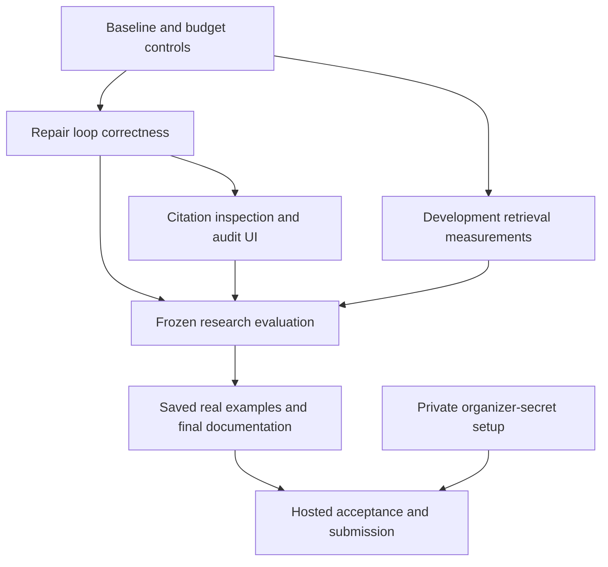

# DeepDive competition improvement plan

**Status:** approved by the user on October 20, 2026; implementation in progress.
**Baseline:** `760ab419886bf9aa35bf07073e68dcb4fa53f854`.
**Prepared:** October 20, 2026.
**Budget instruction:** use only the remaining existing Mesh credit. No purchases.

The official deadline is **October 30, 2026, 23:00 IST / 17:30 UTC**, checked on
October 20. The published judging dimensions include orchestration, the core
verification loop, domain capability, ingestion, evaluation, auditability, and
reproducibility. All AI calls must use Mesh.
[Organizer rules and timeline](https://career.krishnaik.in/hackathons/agent-arena-2026).

This proposal extends the historical approved [PLAN.md](../PLAN.md) and subsequent
[decisions](../docs/decisions.md). It preserves the deployed application and its
existing architecture. Priorities below are engineering recommendations based on
the repository audit; they are not official scoring weights or a promise of rank.

## 1. Intended result

A judge should be able to investigate a real question, inspect an exact source
passage behind each finding, see a rejected claim and the reason, and follow a
repair round from an unanswered facet to new evidence. The repository should
contain reproducible measurements showing what improved and what still fails.

Retain FastAPI, Streamlit, LangGraph, SQLite, the Mesh gateway, current RAG pipeline,
memory, guardrails, exports, Docker, CI, and the Railway deployment. Concentrate
changes on research quality, evaluation, and the judge's inspection workflow.

## 2. Findings from the current code and evidence

| Finding | Evidence | Implication |
|---|---|---|
| The application is deployed and its main workflow works. | [Hosted acceptance](../evaluation/results/railway-hosted.json); 69-test application CI. | Build on this baseline and protect its behavior with regression checks. |
| Web repair requires the previous round to add a source; fresh document queries have a separate exception. | `Workflow.after_coverage` in [workflow.py](../deepdive/workflow.py). | An empty first web round can stop even with a useful new query and available budget. Reproduce and fix this early. |
| Audit events exist, but the Timeline primarily displays a dataframe. | [streamlit_app.py](../streamlit_app.py). | Judges must reconstruct the loop themselves. Present task, round, reason, and outcome directly from stored events. |
| The browser report displays literal HTML reference anchors. | Hosted browser inspection and [hosted limitations](../evaluation/results/railway-hosted.json); Markdown rendering in the UI. | Citation inspection needs a native, safe UI path to the stored passage. |
| Report sections become “Findings 1”, etc.; a claim ID can appear in several sections. Similar claims also have distinct IDs. | `Workflow.synthesize` and `Artifacts.render`; [live document observations](../evaluation/results/live-document-acceptance.json). | Improve organization and conservative deduplication while preserving verified claim text and provenance. |
| Three of eleven retrievals fell back after invalid reranking responses in one live run. | [Live document acceptance](../evaluation/results/live-document-acceptance.json). | Test the reranker contract and measure failure frequency and retry cost. Do not assume the cause without reproducing it. |
| Perfect retrieval scores are document-level scores on ten small authored documents and seven queries. Dense retrieval also scored perfectly. | [RAG results](../evaluation/results/live-rag.json), `rank_metrics` in [rag_evaluation.py](../deepdive/rag_evaluation.py). | Add passage-level labels and harder cases; current results do not prove reranking adds value. |
| Independent label review and the ten-question research benchmark remain pending. | [Evaluation guide](../docs/evaluation.md), [review worksheet](../evaluation/claims-review.md). | This is the largest gap in the evidence for research quality. |
| The benchmark submits all questions with default run limits, then obtains the API's evaluation collection. | Benchmark branch in [evaluation.py](../deepdive/evaluation.py). | Add case selection, bounded execution, isolated storage, resumability, and metrics restricted to benchmark run IDs before spending credit. |
| “follow_up” is currently an independent question, without a preceding turn. | [questions.v1.json](../evaluation/questions.v1.json). | Make follow-up evaluation exercise a real session and evidence reuse. |
| Organizer eligibility is incomplete. | Repository-secret inspection on October 20: neither required secret present; [official check failure](https://github.com/Ben-cod1ng/DeepDive/actions/runs/39452935047). | Resolve account setup alongside technical work, then verify the submitted commit on the dashboard. |

This was a targeted source/evidence audit, not a fresh execution of the entire
test suite or a new live model benchmark. Existing results retain their original
dates and code hashes.

An isolated call to `Workflow.after_coverage` reproduced the empty-first-round
case on October 20: zero sources, a missing facet, a fresh suggested web query,
and available budget selected `synthesize`. This check made zero model calls.

## 3. Implementation order and acceptance

### A. Establish the baseline and protect the credit

1. Record the candidate commit and existing evaluation artifacts without replacing
   historical results. Add a small current evidence index so dated records such as
   `validation-status.json` are not mistaken for the latest state.
2. Add benchmark case selection, explicit per-run limits, an isolated data
   directory, output checkpointing, and resume-by-case/configuration identity.
   A changed case, model, source snapshot, or pipeline starts a new experiment.
3. Count chat, embedding, formatting-repair, and transport-retry attempts. Record
   prompt/output tokens where supplied. Only label dollar amounts as measured when
   the provider reports them; otherwise record a dated pricing estimate.
4. Obtain the current remaining balance through a documented metadata endpoint
   or the owner's dashboard before live evaluations. The last known top-up is not
   the current balance. Keep at least half of the measured remaining balance for
   demo use; this is a proposed allocation, not permission to buy more credit.
5. Plan a conservative maximum batch cost using current prices and request limits.
   If that upper bound cannot be established, defer the batch. A model-call limit
   alone is not a dollar limit. Reconcile usage between batches.

**Acceptance:** a simulated interruption resumes without rerunning completed
cases; unrelated application runs never enter benchmark metrics; retries consume
the stated budget; no live evaluation starts just because credentials exist.

**Files:** `deepdive/evaluation.py`, `deepdive/gateway.py`, evaluation datasets,
focused evaluation tests, `docs/evaluation.md`.

### B. Strengthen and explain the research repair loop

1. Add a regression case for an empty initial web result followed by a new,
   productive query. Permit that bounded repair when budget remains.
2. Track attempted normalized queries and evidence progress for web and document
   research. Avoid repeated ineffective queries and endless repairs. Record why
   another round was selected or why research stopped.
3. Persist per-round task/facet state, new source/passage IDs, accepted/rejected
   claim IDs, and unresolved gaps. Derive this from real records; do not manufacture
   a successful loop for the demo.
4. Keep rejection reasons and verification statuses distinct. Represent unresolved
   disagreements with linked existing claims/passages and their dates; a coverage
   assessor's explanation remains an assessment until independently supported.
5. Add regression cases for transient empty discovery, repeated empty queries,
   conflicting evidence, exhausted budget, parallel task completion, and restart
   during review. Reuse existing fixtures where they express the behavior.

**Acceptance:** the empty-first-round regression obtains evidence through a new
query; repeated failures stop with an explicit reason; unsupported claims cannot
cross the publication gate. Existing recovery and review behavior continues to
pass. Live repair effectiveness is reported later, separately from fixture tests.

**Files:** `deepdive/workflow.py`, `deepdive/tools.py`, relevant models/store records,
`tests/test_workflow.py`, lifecycle/boundary tests.

### C. Make findings and evidence easy to inspect

1. Render findings from the structured outline and verified claim records using
   native Streamlit controls. Give each finding an “Inspect evidence” action
   showing its complete cited passages, exact supporting quotations, source
   URL/document location, timestamp, and verification reason.
2. Use compact display references such as `[1]`, consistently mapped to stable
   passage IDs. Remove raw anchor markup from the browser presentation without
   enabling arbitrary source/model HTML.
3. Use safe topic labels derived from existing task text or a validated finite
   heading policy. Keep factual claim text unchanged after verification.
4. Deduplicate repeated claim IDs and exact duplicate findings conservatively.
   Preserve citations and the audit trail. Do not merge similar statements with
   different numbers, dates, populations, qualifications, or polarity.
5. Add a compact run summary: planned tasks, concurrent research activity, current
   round, findings retained, claims rejected, and unanswered facets. Read these
   from stored state/events. Keep the raw audit download available.
6. Present revision changes using claim/evidence IDs: retained, removed, and added
   findings. An approved report and all exports must refer to the same version.

**Acceptance:** browser tests open a citation and show the matching passage;
untrusted HTML remains inert; duplicate claims are suppressed without losing
distinct contradictory findings; exported reports remain traceable. A reviewer
can follow a repair round without reading JSON.

**Files:** `streamlit_app.py`, a small shared presentation helper if needed,
`deepdive/artifacts.py`, `deepdive/workflow.py`, UI/export tests.

### D. Improve retrieval where measurements justify it

1. Extend the development corpus with longer real/public documents, precise
   identifiers, dates, definitions, tables, near-duplicate sections, and conflicting
   passages. Record source URLs, retrieval times, hashes, and reuse permissions.
2. Add passage-level relevance judgments alongside current document-level metrics.
   Include answer-absent cases and mixed web/document questions.
3. Audit chunk boundaries and section/table context offline. Use a small development
   subset to compare a limited number of chunk sizes only if failures warrant it.
   Preserve immutable original text, page/section locations, and scope filtering.
4. Reproduce invalid reranker output with captured, sanitized failure categories
   and focused fixtures. Improve prompt/schema feedback only for observed failures;
   retain the bounded hybrid-order fallback and label it honestly.
5. Compare BM25, dense, fused, and reranked results under the same corpus and query
   budget. Report quality, latency, attempts, and cache behavior. Change the default
   configuration only if development evidence supports it, then test on held-out
   cases without retuning.

**Acceptance:** all rankings reference eligible existing passages; answer-absent
and contradictory cases remain distinguishable; results show per-stage retrieval
metrics and fallbacks. No claim of a universally “best” chunk size or of improved
retrieval without a measured comparison.

**Files:** `deepdive/documents.py`, `deepdive/document_parser.py`, `deepdive/rag.py`,
`deepdive/rag_evaluation.py`, versioned evaluation data and RAG tests.

### E. Produce credible research-quality evidence

1. Freeze ten research scenarios before the final live benchmark: technical,
   scientific, comparative, temporal, numerical, conflicting-source,
   insufficient-evidence, attributed-opinion, mixed-document/web, and genuine
   multi-turn follow-up. Version any changes to the existing question set.
2. Define required answer facets and reference passages separately from the
   planner's own facets. A planner must not improve its score by omitting difficult
   parts of the question. Separate development cases from held-out evaluation.
3. Give a human reviewer blind worksheets for the existing 32 verifier cases and
   final benchmark claims. Preserve corrections, reviewer identity, date, and
   dataset hash. Assistant/model review may help triage but must not be described
   as independent human review.
4. Measure citation existence, independently assessed claim support, completeness
   against reference facets, rejected/retained claims, repaired facets, retrieval
   failures, latency, calls, and tokens. Report counts and undefined metrics
   explicitly. Small samples do not establish general accuracy.
5. Compare the first round with the repaired result using the same run's recorded
   snapshots. This is a within-run improvement measurement, not a randomized
   ablation. An optional matched no-repair baseline is evaluated only if the
   remaining credit permits it, with fixed sources/configuration.
6. Run a bounded live web pilot first. If successful, run remaining cases only
   within the available evaluation allocation. Publish every attempted case,
   including failures and budget-skipped cases; do not claim a complete
   ten-question benchmark when only a subset ran.

**Acceptance:** every published result identifies dataset, source snapshot,
pipeline, model, configuration, date, and tested commit. At least one real web
research run is inspected end to end. A claim of live rejection or successful
repair links to an actual recorded example. If no such example occurs, report
that limitation instead of fabricating one.

Keep the existing release thresholds (reviewed labels, verifier precision >= 0.90,
recall >= 0.50) intact. Independent final-report review remains a separate measure.
No quality threshold is weakened to make an experiment green.

The distinction between answer quality and citation quality is also supported by
the [ALCE research](https://aclanthology.org/2023.emnlp-main.398/). We will use our
documented metrics and dataset, not imply that running this project reproduces
ALCE or an external benchmark.

### F. Finish the judge walkthrough and submission

1. Provide two or three saved investigations selected from actual successful runs:
   ordinary web research, disagreement/repair, and document comparison. Each
   carries its original date, configuration, source provenance, and limitations.
2. Make saved runs easy to inspect without starting new model calls. Clearly
   label recorded examples and distinguish them from a newly running investigation.
3. Prepare a concise walkthrough covering the question, parallel research,
   rejection reason, repair result, citation inspection, revision, and export.
   Include only steps demonstrated by the saved evidence; an optional video can
   use these real runs.
4. Update the README with a judging-criteria-to-code/evidence map, new diagrams
   where behavior changes, measured comparisons, limitations, and setup guidance.
5. Recheck remaining Railway hosting credit separately from Mesh credit. Keep
   the shared-workspace boundary visible, verify backups/restore, and run final
   browser acceptance on the deployed candidate.
6. Configure the GitHub organizer secrets privately, verify the official checks
   on the selected commit, and confirm the repository submission in the dashboard.
   The user must supply the dashboard's submission token through a secure channel.

**Acceptance:** another person can open the demo, understand a saved investigation,
inspect evidence, and download a report; the final application CI and official
eligibility checks pass; dashboard submission is confirmed.

## 4. Dependencies and budget fallback

Use offline regression tests and existing saved evidence while implementation is
changing. Run paid evaluation only on a stable candidate. Avoid repeated full
benchmarks for documentation-only changes.

If credit cannot fund the complete plan, prioritize loop correctness, citation
inspection, independent review of existing evidence, one bounded live web pilot,
and submission eligibility. Preserve all existing features. Record unperformed
evaluations as pending and keep funds for judge access. Extensive model sweeps,
new paid search services, framework migrations, distributed infrastructure, and
automatic training are outside this proposal.

Work follows the acceptance order above. Aim to have a stable candidate and
submission verified on October 29; use October 30 for recovery and final checks.
This is a planning target, not an assurance that unmeasured quality gates will pass.

## 5. Decisions and prerequisites

- **Confirmed:** remaining existing Mesh credit only; no new credit purchase.
- **Confirmed:** deadline October 30, with exact time verified from the organizer.
- **Approved:** priorities A–F and retaining half the measured remaining Mesh
  balance for demo use.
- **Approval received:** full implementation scope, subject to the credit limit.
- **External input:** independent human label/report review and the private
  organizer submission token. These do not block offline fixes or review tooling.
- **Measured:** initial Mesh balance and model prices were read through metadata;
  half is reserved in a private, persistent allocation. Two development web pilots
  are recorded separately, including the initial quotation-formatting failure.
  Final independent quality and credit available through judging remain unmeasured.

## 6. Implementation progress

- [x] A: isolated case selection, interruption/resume checks, persistent spending
  reservations, model/embedding/retry accounting, and an evidence index.
- [x] B: empty-first-round regression, normalized attempts, bounded stop reasons,
  task events, and per-round evidence/claim snapshots; recovery tests pass.
- [x] C: native citation inspection, conservative grouping, shared export ordering,
  revision comparisons and visible research rounds; offline UI tests pass.
- [x] D: frozen 50-chunk public-document corpus, exact-span boundary audit,
  passage-level metrics, answer-absent cases and distinct rerank fallback reasons.
- [x] D: inspect all seven live retrieval queries, preserve stage rankings and
  answer-absent limits; no held-out tuning. Passage Recall@3: 0.8611 fused,
  0.9444 reranked across the six answerable cases, with no rerank fallbacks.
- [x] E: freeze ten scenarios, separate reference facets, provide blind worksheets,
  and retain the real web pilot plus development retest with original manifests.
- [x] E: bounded held-out mixed-source case inspected; incomplete coverage and a
  potential semantic false positive recorded. Stop further paid batches with
  $0.8692058 available and the original $0.67373855 demo reserve intact.
- [ ] E: independent human review; eight scenarios remain unrun under the budget
  fallback. No live successful repair round was observed.
- [x] F: recorded document example and public-domain web excerpt, judge guide and
  README evidence map. Hosting credit checked separately: 29 trial days remained.
- [ ] F: final required CI, hosted browser acceptance, organizer secrets and dashboard confirmation.
